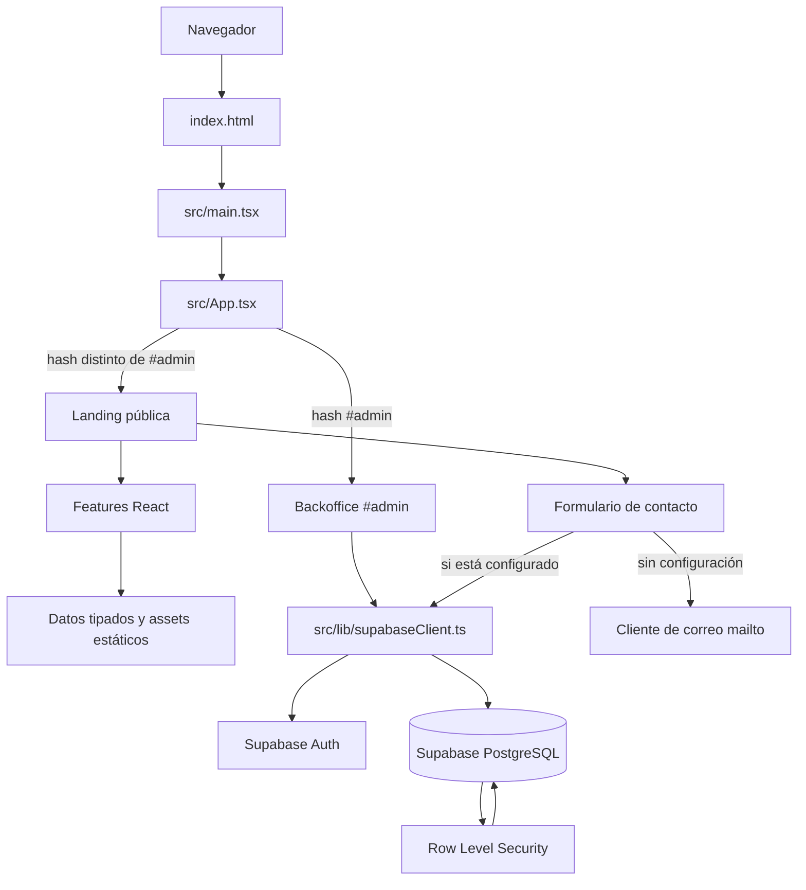

# Contexto de arquitectura

## Diagrama conceptual

## Capas y responsabilidades

### 1. Presentación y composición

`index.html` proporciona el documento base, fuentes web y el nodo `#root`. `src/main.tsx` monta React con `StrictMode`. `src/App.tsx` decide cuál de las dos superficies renderizar mediante `window.location.hash` y compone las secciones de la landing pública.

La landing está organizada por features (`header`, `hero`, `stats`, `perspectives`, `sponsors`, `panels`, `levels`, `venue`, `contact`, `media`, `footer`). Cada feature controla su presentación y, habitualmente, contiene un CSS Module propio. `SectionBoundary` aísla errores de renderizado por región.

### 2. Datos y dominio de interfaz

`src/types/congress.ts` contiene tipos como `CongressPanel`, `Perspective`, `SponsorshipSelection` y valores de formulario. `src/data/` contiene contenido local tipado que consumen secciones. `src/admin/adminTypes.ts` refleja los datos que presenta el backoffice. Los recursos gráficos y audiovisuales públicos residen bajo `public/assets/`.

Las secciones públicas no se comportan como un CMS dinámico por el solo hecho de que exista un esquema en Supabase. El repositorio contiene datos estáticos locales para varias partes de la landing; las vistas de backoffice sí realizan operaciones explícitas sobre tablas.

### 3. Lógica de interfaz

El estado de selección de interés/nivel de patrocinio vive en `App` para comunicar las opciones de niveles con `ContactForm`. El formulario mantiene los campos y un estado discriminado de envío localmente. La cuenta regresiva, estadísticas y preferencia de movimiento reducido se encapsulan en hooks.

### 4. Acceso a servicios externos

`src/lib/supabaseClient.ts` construye el SDK de Supabase con `VITE_SUPABASE_URL` y `VITE_SUPABASE_ANON_KEY`; exporta `null` cuando alguna falta. Los componentes que necesitan persistencia/importación consumen este cliente opcional:

- Backoffice: Supabase Auth y operaciones CRUD de patrocinadores, paneles, sedes, medios y mensajes.
- Contacto público: inserta en `contact_messages` cuando hay cliente; de otro modo usa `mailto`.

No se observa un backend HTTP propio, API server, capa de repositorios ni integración de pagos.

### 5. Persistencia y permisos

`supabase/congreso.sql` declara PostgreSQL con entidades relacionadas por UUID y claves foráneas. Incluye ediciones, niveles de patrocinio, patrocinadores, paneles y ponentes, sedes y amenidades, elementos multimedia y mensajes de contacto. El archivo habilita RLS y define políticas públicas de lectura para contenido activo/publicado, inserción pública de mensajes y operaciones para usuarios autenticados.

`supabase/fix-rls-admin.sql` agrega políticas equivalentes de administración para usuarios autenticados, como corrección operativa de errores de autorización. Estas políticas son amplias: cualquier usuario autenticado obtiene operaciones `ALL` sobre las tablas cubiertas. El esquema comenta que en producción conviene restringirlas a un rol administrador propio. El formulario público obtiene un alta, no un permiso general de lectura de mensajes.

## Límites de contexto (Bounded Contexts)

Estos son límites de responsabilidad del código, no módulos de negocio completamente aislados por capas:

| Contexto | Responsabilidad | Datos/servicios principales |
|---|---|---|
| Landing y difusión | Presentar el congreso, agenda, perfiles, sede, sponsors y medios | Componentes React, `src/data/`, assets estáticos |
| Captación de interés | Recoger solicitudes de asistencia/patrocinio y su nivel seleccionado | `ContactForm`, tipo `ContactFormValues`, tabla `contact_messages` o `mailto` |
| Administración de contenidos | Gestionar contenido visible y mensajes recibidos | `AdminApp`, Supabase Auth, tablas `sponsors`, `panels`, `venues`, `media_items`, `contact_messages` |
| Ediciones del congreso | Agrupar contenido por ciudad/edición y periodo | `congress_editions`, claves `edition_id` |
| Plataforma externa | Proveer autenticación, PostgreSQL, políticas y plantillas de confirmación | Supabase y su configuración externa |

La separación es principalmente de interfaz/feature. Algunos modelos del esquema aún no aparecen como una pantalla de administración (por ejemplo, `panel_speakers`, `venue_amenities` y edición de niveles/ediciones).

## Comunicación y flujo de información

### Ruta pública

El punto de entrada resuelve el hash y renderiza la landing. La composición entrega selección de patrocinio al formulario mediante props/callback. Las secciones consumen sus datos locales y recursos públicos. El hook de estadísticas espera a que el elemento entre en viewport mediante `IntersectionObserver`; la cuenta regresiva usa un intervalo limpiado al desmontar. Las preferencias de movimiento reducido se observan con `matchMedia`.

El formulario valida lo esencial en el navegador, construye el cuerpo del mensaje y, si Supabase está configurado, inserta `full_name`, `role`, `company`, `organization`, `email`, `interest` y `message`. El texto del mensaje contiene el nivel seleccionado, pero el formulario no guarda actualmente `sponsorship_tier_id`. Si no hay cliente, redirige a un `mailto`; esa ruta depende de que el usuario tenga un cliente de correo configurado y no confirma persistencia.

### Ruta de administración

La ruta se activa en `/#admin`. La autenticación usa sesión de Supabase: se carga la sesión existente y se escucha `onAuthStateChange`. Los formularios de acceso permiten iniciar sesión o registrarse; el registro solicita confirmación por correo y redirige a `/#admin`. Tras autenticar, el usuario selecciona una sección y puede listar/crear/editar/eliminar los recursos implementados. La autorización final no se decide solo en React: la aplica RLS en PostgreSQL.

## Decisiones de arquitectura implícitas

1. **SPA estática servible por Vite:** existe un bundle frontend sin servidor de aplicación propio; el `hash` permite exponer administración sin un router adicional.
2. **React por features:** se prefirió composición de secciones de landing en lugar de una única página monolítica. No implica que haya una arquitectura Clean formal.
3. **CSS Modules y tokens compartidos:** los estilos de componentes están aislados, con valores de marca centrales y breakpoint móvil de 760 px.
4. **Supabase como BaaS:** autenticación y base de datos se acceden desde navegador con el SDK oficial. RLS es un límite esencial de seguridad.
5. **Fallback de contacto:** la falta de configuración no impide renderizar la landing; el formulario cae a `mailto` en vez de fallar al inicializar.
6. **Contenido híbrido:** datos de landing incluidos en el bundle y contenido administrable persistido coexisten. No asumir sincronización automática entre ambos.
7. **Diseño accesible y tolerante a fallos:** hay hook de movimiento reducido y boundaries por sección, aunque estos mecanismos no sustituyen validación funcional o monitoreo.

## Interacciones externas

- **Supabase Auth:** login, registro, sesión y confirmación por correo. La plantilla debe configurarse en el dashboard de Supabase según `README.md`.
- **Supabase PostgreSQL:** CRUD del backoffice e inserción de mensajes públicos, protegidos por políticas RLS configuradas por SQL.
- **Google Fonts:** carga externa de Manrope y Bebas Neue declarada en `index.html`.
- **Google Maps:** el esquema permite guardar URL/coordenadas para sedes, pero no implica un SDK de mapas; el backoffice almacena estos campos.
- **Aplicación de correo del usuario:** destino fallback `mailto:congreso@weecompany.net` si no se configuró Supabase.

## Consideraciones de evolución

- Reemplazar las políticas RLS de administración abiertas a todo usuario autenticado por un rol/permisos administrativos explícitos antes de depender de ellas en producción.
- Decidir si la landing debe seguir usando contenido estático o consumir el CMS de Supabase, y definir una migración completa y coherente antes de conectar más pantallas.
- Mantener alineados el esquema SQL, los tipos TypeScript y los formularios CRUD; actualmente varios tipos son interfaces manuales y los datos Supabase se convierten mediante aserciones de tipo.
- Establecer migraciones versionadas, pruebas y un procedimiento de despliegue si la evolución requiere cambios frecuentes del esquema.
